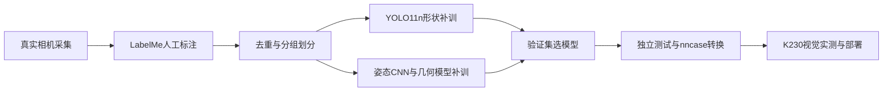

# K230 七类物块视觉识别工程

从实拍采集、标注、训练环境搭建，到 YOLO11n 形状补训、立放/横躺姿态分类、ONNX 导出、K230 转换与部署的完整工程。

当前模型 **vision-supplement-20261015-v1**，已于 **2026-10-16** 在 K230 上验证三棱柱、五棱柱、圆柱的立放与横躺。颜色算法为 **white-lab-foreground-20261014-v1**。固件使用 CanMV v1.8 / nncase 2.11.0。



## 按这个顺序阅读

1. [环境搭建与软件下载](docs/01_setup.md)
2. [拍照、标注和数据整理](docs/02_dataset.md)
3. [训练七类形状模型](docs/03_shape_training.md)
4. [训练立放／横躺姿态模型](docs/04_pose_training.md)
5. [ONNX、K230模型转换与测试](docs/05_conversion.md)
6. [复制到K230、预览及接入分拣](docs/06_deployment.md)
7. [颜色识别、补拍与问题排查](docs/07_maintenance.md)
8. [当前版本的验证结果与复现范围](docs/08_results.md)

## 七类编号必须保持不变

| ID | 英文标签 | 中文 |
|---:|---|---|
| 0 | hollow_cube | 镂空正方体 |
| 1 | tetrahedron | 正四面体 |
| 2 | pentagonal_prism | 五棱柱 |
| 3 | triangular_prism | 三棱柱 |
| 4 | cone | 圆锥 |
| 5 | cylinder | 圆柱 |
| 6 | hemisphere | 半球 |

## 第一次使用

在 Windows PowerShell 中进入仓库根目录，建立环境，安装GPU或CPU版PyTorch后再安装固定依赖：

```powershell
py -3.13 -m venv .venv
# 有兼容NVIDIA显卡时；仅CPU请看环境文档中的替代命令
.\.venv\Scripts\python.exe -m pip install torch==2.8.0 torchvision==0.23.0 --index-url https://download.pytorch.org/whl/cu128
.\.venv\Scripts\python.exe -m pip install -r requirements/train.txt
.\.venv\Scripts\python.exe -m unittest discover -s tests -v
```

准备自己已标注的照片后：

```powershell
.\.venv\Scripts\python.exe training/prepare_dataset.py --source data/raw --output data/prepared/v1 --allow-empty
.\.venv\Scripts\python.exe training/audit_dataset.py --data data/prepared/v1/data.yaml
.\.venv\Scripts\python.exe training/train_shape.py --data data/prepared/v1/data.yaml --run runs/v1 --dry-run
.\.venv\Scripts\python.exe training/train_shape.py --data data/prepared/v1/data.yaml --run runs/v1 --device 0
.\.venv\Scripts\python.exe training/select_shape.py --data data/prepared/v1/data.yaml --run runs/v1
```

`--allow-empty`只适用于已经人工确认的空盘标注，不能把未标注的混摆图当空盘。默认从仓库当前权重继续补训；随机初始化见训练文档。

## 仓库内容

| 目录 | 内容 |
|---|---|
| training | 路径可配置的数据整理、检查、训练、选模、转换、评估及打包脚本 |
| configs | 固定类别表、实际使用的形状训练配方 |
| models/current | 当前形状与姿态 PT / ONNX 权重 |
| deployment/board_files | 与当前已部署版一致的 K230 视觉运行文件、kmodel 和配置 |
| deployment/capture_photos.py | 连接 K230 摄像头采集未画框原图 |
| reports | 去除个人路径后的指标和环境记录 |
| tests | 关键数据处理、颜色公式和部署文件一致性检查 |

原始实拍照片、原电脑环境、设备备份及机械标定未上传。准备自己的数据即可执行同一路线；精确重跑20261015那次训练还需要当时完整数据与初始权重，见[复现范围](docs/08_results.md)。本工程是视觉模块，机械抓取程序由队友维护。

当前七类模型固定320×320 RGB输入，姿态CNN为96×96。更改尺寸、类别顺序或固件nncase版本时，需要重新核对整条转换与推理链。
